# Footprint conformance (BPM 2026): paper vs. implementations

This report compares three versions of the footprint-based conformance check for object-centric process trees:

| Version | Source |
|---|---|
| **Python**: the implementation linked in the paper | `Nik314/OCPT-Conformance-Checking @ 02ee336` |
| **rust4pm**: the Rust port | `BPM-Research-Group/rust4pm_BPM @ fcbfdb4`, `process_mining/src/conformance/object_centric/` |
| **Paper (reference)**: a direct implementation of Defs. 2–10 and Sec. 3.3, written for this report | `reference.py` |

For each detected difference there is a small separating example: an OCPT and an OCEL on which the versions disagree. All three versions run on the same input files. The report lists the pattern values that differ, the resulting category scores, and a question about the intended behaviour.

**How to read the tables**
- A pattern value of 1 means the behaviour is present (log) or allowed (tree).
- For identity patterns, 1 means the implication is violated (log) or not enforced (tree).
- ⚠️ marks a value that differs from the paper reference.
- **Category scores can also differ because of other issues in this report.** The usual causes are double counting (Issue 10), loops marking activities as optional in rust4pm (Issue 16), the loop self-edge in Python (Issue 5), and identity precision being 0 under the paper's literal reading (Issue 14). Each section's verdict is based only on the highlighted patterns.

## Summary

| # | Issue | Python | rust4pm |
|---|---|---|---|
| [1](#1-tree-df-a-sequence-links-to-the-end-of-the-next-child-and-takes-ends-from-starts) | Tree DF: a sequence links to the *end* of the next child and takes ends from starts | ⚠️ differs from paper | ✅ agrees with paper |
| [2](#2-tree-df--and--report-their-start-activities-as-end-activities) | Tree DF: ∧ and × report their *start* activities as end activities | ⚠️ differs from paper | ✅ agrees with paper |
| [3](#3-tree-df-a-sequence-does-not-link-across-a-skippable-child-eq-13) | Tree DF: a sequence does not link across a skippable child (eq. 13) | ⚠️ differs from paper | ✅ agrees with paper |
| [4](#4-tree-df--is-treated-as-skippable-if-any-child-is-skippable-eq-5-says-all) | Tree DF: ∧ is treated as skippable if *any* child is skippable (eq. 5 says all) | ⚠️ differs from paper | ✅ agrees with paper |
| [5](#5-tree-df-a-loop-always-links-the-bodys-end-to-the-bodys-start) | Tree DF: a loop always links the body's end to the body's start | ⚠️ differs from paper | ✅ agrees with paper |
| [6](#6-paper-leaves-unrelated-to-a-type-and-τ-are-not-skippable-under-the-literal-leaf-rule) | Paper: leaves unrelated to a type (and τ) are not skippable under the literal leaf rule | ⚠️ differs from paper | ✅ agrees with paper |
| [7](#7-log-div-python-uses-df2-divergence-rust4pm-and-the-paper-use-object-in-1-a-events) | Log `div`: Python uses DF2 divergence, rust4pm and the paper use 'object in >1 a-events' | ⚠️ differs from paper | ✅ agrees with paper |
| [8](#8-tree-con-a-leaf-that-allows-convergence-does-not-yield-the-pattern-in-the-implementations) | Tree `con`: a leaf that allows convergence does not yield the pattern in the implementations | ⚠️ differs from paper | ⚠️ differs from paper |
| [9](#9-tree-def-a-leaf-that-allows-deficiency-does-not-yield-the-pattern-in-the-implementations) | Tree `def`: a leaf that allows deficiency does not yield the pattern in the implementations | ⚠️ differs from paper | ⚠️ differs from paper |
| [10](#10-pattern-universe-activities-in-both-log-and-tree-are-counted-twice) | Pattern universe: activities in both log and tree are counted twice | ⚠️ differs from paper | ⚠️ differs from paper |
| [11](#11-identity-object-wise-check-flags-a-violation-that-def-4-does-not) | Identity: object-wise check flags a violation that Def. 4 does not | ⚠️ differs from paper | ⚠️ differs from paper |
| [12](#12-identity-events-without-objects-of-the-implying-type-are-ignored-by-the-implementations) | Identity: events without objects of the implying type are ignored by the implementations | ⚠️ differs from paper | ⚠️ differs from paper |
| [13](#13-identity-universe-pairs-with-a--b-are-excluded-by-the-implementations) | Identity universe: pairs with a = b are excluded by the implementations | ⚠️ differs from paper | ⚠️ differs from paper |
| [14](#14-identity-a-pattern-that-never-applies-in-the-log-counts-as-violated-1-in-the-implementations) | Identity: a pattern that never applies in the log counts as violated (1) in the implementations | ⚠️ differs from paper | ⚠️ differs from paper |
| [15](#15-identity-rust4pm-reads-sync-as-both-directions-python-only-as-left--right) | Identity: rust4pm reads Sync as both directions, Python only as left ⇒ right | ⚠️ differs from paper | ✅ agrees with paper |
| [16](#16-tree-opt-an-activity-in-a-loops-redo-part-can-occur-zero-times-but-no-pattern-says-so) | Tree `opt`: an activity in a loop's redo part can occur zero times, but no pattern says so | ✅ agrees with paper | ⚠️ differs from paper |
| [17](#17-evaluation-script-table-1-absolute-difference-uses-one-category-only) | Table 1 computed from the control-flow category only | — (evaluation script) | — |
| [18](#18-typos-in-the-definitions) | Typos in Def. 3 and Def. 5 | — | — |
| [19](#19-harmless-code-oddity-no-behavioural-effect) | Harmless filter in `interaction_properties.py` | no effect | — |
| [20](#20-outside-the-footprint-df2-graph-loses-end-activities-python-miner) | DF2 graph loses end activities (miner) | ⚠️ bug | — |

## 1. Tree DF: a sequence links to the *end* of the next child and takes ends from starts

**Result:** Python ⚠️ differs from paper · rust4pm ✅ agrees with paper

**Paper.** Eq. 13: in a sequence, the **end** activities of child *i* are followed by the **start** activities of child *i+1*. Eq. 11: the ends of the sequence are the ends of the last non-skippable child and of the children after it.

**Implementations.** `OCPT-Conformance-Checking/src/tree_abstraction.py:176` links `sub_end` to `sub_dfgs[i+1][2]`, which is the **end** set of the next child. `:174` collects the sequence's ends with `end.update(sub_start)`. For a leaf, start = end, so flat sequences come out right. Nested sequences do not.

**Separating example** (`cases/01_seq_links_to_end/`). Highlighted nodes and events are where the behaviour diverges.

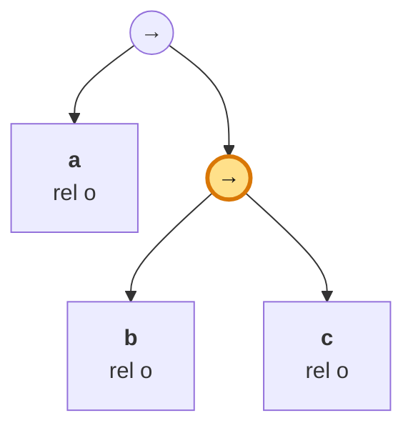

| # | activity | objects |
|---|---|---|
| e1 | a | o1 |
| e2 | b | o1 |
| e3 | c | o1 |

Object traces: o1: ⟨a, b, c⟩

**Pattern values** (1 = pattern holds, i.e. behaviour present/allowed; for identity: implication violated / not enforced; — = not part of that implementation's pattern universe; ⚠️ = differs from the paper reference):

| pattern | Python log | Python tree | rust4pm log | rust4pm tree | Paper (reference) log | Paper (reference) tree |
|---|---|---|---|---|---|---|
| df<sub>o</sub>(a→b) | 1 | **0** ⚠️ | 1 | 1 | 1 | 1 |
| df<sub>o</sub>(a→c) | 0 | **1** ⚠️ | 0 | 0 | 0 | 0 |
| end<sub>o</sub>(b) | 0 | **1** ⚠️ | 0 | 0 | 0 | 0 |
| end<sub>o</sub>(c) | 1 | **0** ⚠️ | 1 | 1 | 1 | 1 |

**Category scores:**

| | control fit / prec | multiplicity fit / prec | identity fit / prec |
|---|---|---|---|
| Python | 0.500 / 0.500 | 1.000 / 1.000 | 1.000 / 1.000 |
| rust4pm | 1.000 / 1.000 | 1.000 / 1.000 | 1.000 / 1.000 |
| Paper (reference) | 1.000 / 1.000 | 1.000 / 1.000 | 1.000 / 1.000 |

> **Question:** Confirm this is a bug, i.e. the intended tree footprint is a→b, b→c with end {c}, as eqs. 11 and 13 say.

## 2. Tree DF: ∧ and × report their *start* activities as end activities

**Result:** Python ⚠️ differs from paper · rust4pm ✅ agrees with paper

**Paper.** Eq. 2: the end activities of ∧ (and, analogously, of ×) are the union of the children's **end** activities.

**Implementations.** `OCPT-Conformance-Checking/src/tree_abstraction.py:190` (×) and `:204` (∧) use `end.update(sub_start)`. So the composite's end set is its start set. Here the ∧ reports end {a, c} instead of {b, c}, and the sequence then links a→d instead of b→d.

**Separating example** (`cases/02_par_ends_from_starts/`). Highlighted nodes and events are where the behaviour diverges.

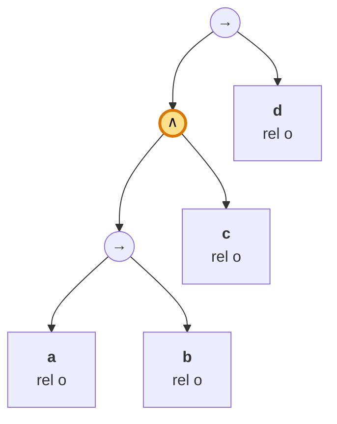

| # | activity | objects |
|---|---|---|
| e1 | a | o1 |
| e2 | c | o1 |
| **e3** 🟨 | **b** | **o1** |
| **e4** 🟨 | **d** | **o1** |

Object traces: o1: ⟨a, c, b, d⟩

**Pattern values** (1 = pattern holds, i.e. behaviour present/allowed; for identity: implication violated / not enforced; — = not part of that implementation's pattern universe; ⚠️ = differs from the paper reference):

| pattern | Python log | Python tree | rust4pm log | rust4pm tree | Paper (reference) log | Paper (reference) tree |
|---|---|---|---|---|---|---|
| df<sub>o</sub>(b→d) | 1 | **0** ⚠️ | 1 | 1 | 1 | 1 |
| df<sub>o</sub>(a→d) | 0 | **1** ⚠️ | 0 | 0 | 0 | 0 |
| df<sub>o</sub>(c→d) | 0 | 1 | 0 | 1 | 0 | 1 |

**Category scores:**

| | control fit / prec | multiplicity fit / prec | identity fit / prec |
|---|---|---|---|
| Python | 0.800 / 0.400 | 1.000 / 1.000 | 1.000 / 1.000 |
| rust4pm | 1.000 / 0.500 | 1.000 / 1.000 | 1.000 / 1.000 |
| Paper (reference) | 1.000 / 0.500 | 1.000 / 1.000 | 1.000 / 1.000 |

> **Question:** Confirm the intended ends of ∧/× are the children's ends (eq. 2).

## 3. Tree DF: a sequence does not link across a skippable child (eq. 13)

**Result:** Python ⚠️ differs from paper · rust4pm ✅ agrees with paper

**Paper.** Eq. 13 also links child *i* to child *j > i+1* when every child strictly between them is skippable.

**Implementations.** `OCPT-Conformance-Checking/src/tree_abstraction.py:175-177` only links adjacent children (`i` → `i+1`). The edge a→c over the skippable ×(b, τ) is never produced.

**Separating example** (`cases/03_seq_skip_optional/`). Highlighted nodes and events are where the behaviour diverges.

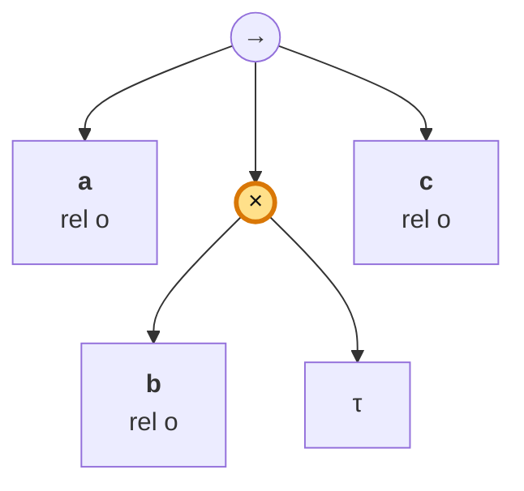

| # | activity | objects |
|---|---|---|
| **e1** 🟨 | **a** | **o1** |
| **e2** 🟨 | **c** | **o1** |
| e3 | a | o2 |
| e4 | b | o2 |
| e5 | c | o2 |

Object traces: o1: ⟨a, c⟩; o2: ⟨a, b, c⟩

**Pattern values** (1 = pattern holds, i.e. behaviour present/allowed; for identity: implication violated / not enforced; — = not part of that implementation's pattern universe; ⚠️ = differs from the paper reference):

| pattern | Python log | Python tree | rust4pm log | rust4pm tree | Paper (reference) log | Paper (reference) tree |
|---|---|---|---|---|---|---|
| df<sub>o</sub>(a→c) | 1 | **0** ⚠️ | 1 | 1 | 1 | 1 |
| df<sub>o</sub>(a→b) | 1 | 1 | 1 | 1 | 1 | 1 |
| df<sub>o</sub>(b→c) | 1 | 1 | 1 | 1 | 1 | 1 |

**Category scores:**

| | control fit / prec | multiplicity fit / prec | identity fit / prec |
|---|---|---|---|
| Python | 0.800 / 1.000 | 1.000 / 1.000 | 1.000 / 1.000 |
| rust4pm | 1.000 / 1.000 | 1.000 / 1.000 | 1.000 / 1.000 |
| Paper (reference) | 1.000 / 1.000 | 1.000 / 1.000 | 1.000 / 1.000 |

> **Question:** Confirm that edges across skippable children are intended (eq. 13).

## 4. Tree DF: ∧ is treated as skippable if *any* child is skippable (eq. 5 says all)

**Result:** Python ⚠️ differs from paper · rust4pm ✅ agrees with paper

**Paper.** Eq. 5: a ∧ node is skippable only if **all** children are skippable.

**Implementations.** `OCPT-Conformance-Checking/src/tree_abstraction.py:205` uses `optional = optional or sub_optional`, starting from False. So ∧(a, τ) counts as skippable, and the following `e` becomes an extra start activity.

**Separating example** (`cases/04_par_skip_any/`). Highlighted nodes and events are where the behaviour diverges.

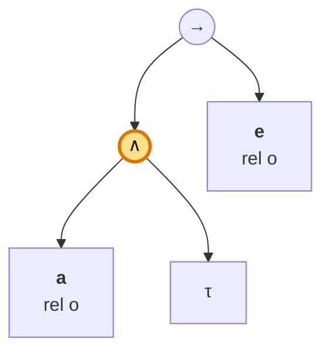

| # | activity | objects |
|---|---|---|
| e1 | a | o1 |
| e2 | e | o1 |

Object traces: o1: ⟨a, e⟩

**Pattern values** (1 = pattern holds, i.e. behaviour present/allowed; for identity: implication violated / not enforced; — = not part of that implementation's pattern universe; ⚠️ = differs from the paper reference):

| pattern | Python log | Python tree | rust4pm log | rust4pm tree | Paper (reference) log | Paper (reference) tree |
|---|---|---|---|---|---|---|
| start<sub>o</sub>(a) | 1 | 1 | 1 | 1 | 1 | 1 |
| start<sub>o</sub>(e) | 0 | **1** ⚠️ | 0 | 0 | 0 | 0 |

**Category scores:**

| | control fit / prec | multiplicity fit / prec | identity fit / prec |
|---|---|---|---|
| Python | 1.000 / 0.750 | 1.000 / 1.000 | 1.000 / 1.000 |
| rust4pm | 1.000 / 1.000 | 1.000 / 1.000 | 1.000 / 1.000 |
| Paper (reference) | 1.000 / 1.000 | 1.000 / 1.000 | 1.000 / 1.000 |

> **Question:** Confirm eq. 5 (all children) is intended.

## 5. Tree DF: a loop always links the body's end to the body's start

**Result:** Python ⚠️ differs from paper · rust4pm ✅ agrees with paper

**Paper.** Loop text in Sec. 3.3: the body's end activities lead to the body's start activities **only if a redo part can be skipped**.

**Implementations.** `OCPT-Conformance-Checking/src/tree_abstraction.py:239` adds `end × start` of the whole loop unconditionally. So ↺(a, b) gets a→a although every repetition must pass through b. The multiplicity scores of this case differ for a separate reason; see Issue 16.

**Separating example** (`cases/05_loop_body_self/`). Highlighted nodes and events are where the behaviour diverges.

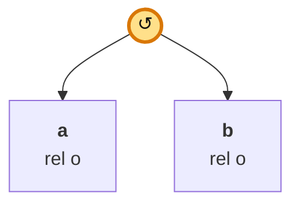

| # | activity | objects |
|---|---|---|
| e1 | a | o1 |
| e2 | b | o1 |
| e3 | a | o1 |

Object traces: o1: ⟨a, b, a⟩

**Pattern values** (1 = pattern holds, i.e. behaviour present/allowed; for identity: implication violated / not enforced; — = not part of that implementation's pattern universe; ⚠️ = differs from the paper reference):

| pattern | Python log | Python tree | rust4pm log | rust4pm tree | Paper (reference) log | Paper (reference) tree |
|---|---|---|---|---|---|---|
| df<sub>o</sub>(a→a) | 0 | **1** ⚠️ | 0 | 0 | 0 | 0 |
| df<sub>o</sub>(a→b) | 1 | 1 | 1 | 1 | 1 | 1 |
| df<sub>o</sub>(b→a) | 1 | 1 | 1 | 1 | 1 | 1 |

**Category scores:**

| | control fit / prec | multiplicity fit / prec | identity fit / prec |
|---|---|---|---|
| Python | 1.000 / 0.800 | 1.000 / 0.500 | 1.000 / 1.000 |
| rust4pm | 1.000 / 1.000 | 1.000 / 0.500 | 1.000 / 1.000 |
| Paper (reference) | 1.000 / 1.000 | 1.000 / 0.750 | 1.000 / 1.000 |

> **Question:** Confirm that a→a should only appear if a redo part is skippable.

## 6. Paper: leaves unrelated to a type (and τ) are not skippable under the literal leaf rule

**Result:** Python ⚠️ differs from paper · rust4pm ✅ agrees with paper · literal paper rule ⚠️ differs from interpreted reference

**Paper.** Sec. 3.3, leaf rule: skip<sub>ot</sub>(leaf) = ot ∈ div<sub>a</sub>. Read **literally**, a leaf *unrelated* to ot (here b for type o) is **not** skippable for ot. Then eq. 13 never links a→c, although object o1's trace is ⟨a, c⟩. The reference implementation therefore treats unrelated leaves (and τ) as skippable by default ("interpreted"). The "literal" column shows what the text gives.

**Implementations.** rust4pm projects the type first and produces a→c. The Python code projects the tree for o (`ocpn_conversion.py:17-22`), which turns b into τ. It then hits the adjacent-only linking of Issue 3 and also misses a→c.

**Separating example** (`cases/06_leaf_skip_rule_paper/`). Highlighted nodes and events are where the behaviour diverges.

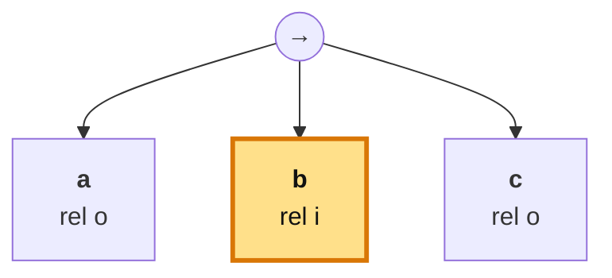

| # | activity | objects |
|---|---|---|
| e1 | a | o1 |
| **e2** 🟨 | **b** | **i1** |
| e3 | c | o1 |

Object traces: i1: ⟨b⟩; o1: ⟨a, c⟩

**Pattern values** (1 = pattern holds, i.e. behaviour present/allowed; for identity: implication violated / not enforced; — = not part of that implementation's pattern universe; ⚠️ = differs from the paper reference):

| pattern | Python log | Python tree | rust4pm log | rust4pm tree | Paper (reference) log | Paper (reference) tree | Paper (literal leaf rule) log | Paper (literal leaf rule) tree |
|---|---|---|---|---|---|---|---|---|
| df<sub>o</sub>(a→c) | 1 | **0** ⚠️ | 1 | 1 | 1 | 1 | 1 | **0** ⚠️ |

**Category scores:**

| | control fit / prec | multiplicity fit / prec | identity fit / prec |
|---|---|---|---|
| Python | 0.800 / 1.000 | 1.000 / 1.000 | 1.000 / 1.000 |
| rust4pm | 1.000 / 1.000 | 1.000 / 1.000 | 1.000 / 1.000 |
| Paper (reference) | 1.000 / 1.000 | 1.000 / 1.000 | 1.000 / 0.000 |

> **Question:** Should the leaf rule read "skip<sub>ot</sub>(leaf) = ot ∈ div<sub>a</sub> ∨ ot ∉ rel<sub>a</sub> ∨ a = τ"? (Paper wording issue, plus Python bug #3.)

## 7. Log `div`: Python uses DF2 divergence, rust4pm and the paper use 'object in >1 a-events'

**Result:** Python ⚠️ differs from paper · rust4pm ✅ agrees with paper

**Paper.** Def. 3/8: rel<sub>a>1,ot</sub> holds if some object of type ot takes part in **more than one** a-event.

**Implementations.** Python, log side (`OCPT-Conformance-Checking/src/interaction_properties.py:38-51`) computes **DF2 divergence**: a-events with the same ot-set but different full object sets. The Python tree side (`tree_abstraction.py:140-141`) and rust4pm's log side (`process_mining/src/conformance/object_centric/object_centric_language_abstraction.rs:701`) use 'more than one a-event'. Here o1 and i1 repeat a together. Paper and rust4pm give div = 1 (matching the loop in the tree). Python gives 0, so precision drops on a perfectly fitting log.

**Separating example** (`cases/07_log_div_meaning/`). Highlighted nodes and events are where the behaviour diverges.

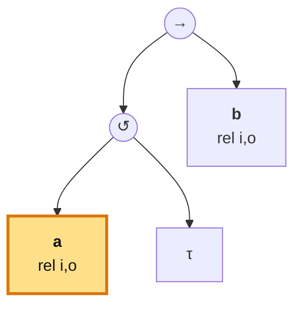

| # | activity | objects |
|---|---|---|
| **e1** 🟨 | **a** | **o1, i1** |
| **e2** 🟨 | **a** | **o1, i1** |
| e3 | b | o1, i1 |

Object traces: i1: ⟨a, a, b⟩; o1: ⟨a, a, b⟩

**Pattern values** (1 = pattern holds, i.e. behaviour present/allowed; for identity: implication violated / not enforced; — = not part of that implementation's pattern universe; ⚠️ = differs from the paper reference):

| pattern | Python log | Python tree | rust4pm log | rust4pm tree | Paper (reference) log | Paper (reference) tree |
|---|---|---|---|---|---|---|
| div (a>1)(a,o) | **0** ⚠️ | 1 | 1 | 1 | 1 | 1 |
| div (a>1)(a,i) | **0** ⚠️ | 1 | 1 | 1 | 1 | 1 |

**Category scores:**

| | control fit / prec | multiplicity fit / prec | identity fit / prec |
|---|---|---|---|
| Python | 1.000 / 1.000 | 1.000 / 0.667 | 1.000 / 0.000 |
| rust4pm | 1.000 / 1.000 | 1.000 / 0.750 | 1.000 / 0.000 |
| Paper (reference) | 1.000 / 1.000 | 1.000 / 1.000 | 1.000 / 0.000 |

> **Question:** Which meaning is intended for the `div` multiplicity pattern on the log side? (The tree side in all three is 'a>1'.)

## 8. Tree `con`: a leaf that allows convergence does not yield the pattern in the implementations

**Result:** Python ⚠️ differs from paper · rust4pm ⚠️ differs from paper

**Paper.** Sec. 3.3: rel<sub>a,ot>1</sub> on the tree side "evaluates to true if any corresponding leaf allows it".

**Implementations.** Both implementations add a recursive condition against the other related types: Python `check_convergence` (`OCPT-Conformance-Checking/src/tree_abstraction.py:57-91`) and rust4pm `compute_conv` / `check_conv_subroutine_for_competitor`. Here leaf a allows i to converge, but the pattern is 0 on the tree side, so a fitting log loses multiplicity fitness.

**Separating example** (`cases/08_tree_con_stricter/`). Highlighted nodes and events are where the behaviour diverges.

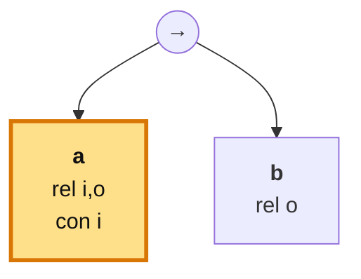

| # | activity | objects |
|---|---|---|
| **e1** 🟨 | **a** | **o1, i1, i2** |
| e2 | b | o1 |

Object traces: i1: ⟨a⟩; i2: ⟨a⟩; o1: ⟨a, b⟩

**Pattern values** (1 = pattern holds, i.e. behaviour present/allowed; for identity: implication violated / not enforced; — = not part of that implementation's pattern universe; ⚠️ = differs from the paper reference):

| pattern | Python log | Python tree | rust4pm log | rust4pm tree | Paper (reference) log | Paper (reference) tree |
|---|---|---|---|---|---|---|
| con (ot>1)(a,i) | 1 | **0** ⚠️ | 1 | **0** ⚠️ | 1 | 1 |

**Category scores:**

| | control fit / prec | multiplicity fit / prec | identity fit / prec |
|---|---|---|---|
| Python | 1.000 / 1.000 | 0.750 / 1.000 | 1.000 / 1.000 |
| rust4pm | 1.000 / 1.000 | 0.750 / 1.000 | 1.000 / 1.000 |
| Paper (reference) | 1.000 / 1.000 | 1.000 / 1.000 | 1.000 / 0.286 |

> **Question:** Is the extra competitor check intended? If yes, the paper should describe it; if no, both implementations need changing.

## 9. Tree `def`: a leaf that allows deficiency does not yield the pattern in the implementations

**Result:** Python ⚠️ differs from paper · rust4pm ⚠️ differs from paper

**Paper.** Same rule as Issue 8, for rel<sub>a,ot<1</sub> (deficiency).

**Implementations.** Python `check_deficient` (`OCPT-Conformance-Checking/src/tree_abstraction.py:96-129`) and rust4pm `compute_def` apply the competitor check. Leaf a allows i to be missing, but the pattern stays 0.

**Separating example** (`cases/09_tree_def_stricter/`). Highlighted nodes and events are where the behaviour diverges.

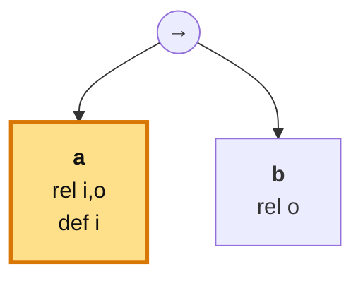

| # | activity | objects |
|---|---|---|
| e1 | a | o1, i1 |
| **e2** 🟨 | **a** | **o2** |
| e3 | b | o1 |
| e4 | b | o2 |

Object traces: i1: ⟨a⟩; o1: ⟨a, b⟩; o2: ⟨a, b⟩

**Pattern values** (1 = pattern holds, i.e. behaviour present/allowed; for identity: implication violated / not enforced; — = not part of that implementation's pattern universe; ⚠️ = differs from the paper reference):

| pattern | Python log | Python tree | rust4pm log | rust4pm tree | Paper (reference) log | Paper (reference) tree |
|---|---|---|---|---|---|---|
| def (ot<1)(a,i) | 1 | **0** ⚠️ | 1 | **0** ⚠️ | 1 | 1 |

**Category scores:**

| | control fit / prec | multiplicity fit / prec | identity fit / prec |
|---|---|---|---|
| Python | 1.000 / 1.000 | 0.750 / 1.000 | 1.000 / 1.000 |
| rust4pm | 1.000 / 1.000 | 0.750 / 1.000 | 1.000 / 1.000 |
| Paper (reference) | 1.000 / 1.000 | 1.000 / 1.000 | 1.000 / 0.714 |

> **Question:** As Issue 8, for deficiency.

## 10. Pattern universe: activities in both log and tree are counted twice

**Result:** Python ⚠️ differs from paper · rust4pm ⚠️ differs from paper

**Paper.** Sec. 3.2: there are 5·|Σ|·|Ω| multiplicity patterns and |Σ|²·|Ω|² identity patterns, over the **set** of activities.

**Implementations.** Both implementations iterate over `total_activities = list(log_rel) + list(tree_rel)` (Python `OCPT-Conformance-Checking/src/conformance.py:27`, rust4pm `process_mining/src/conformance/object_centric/footprint_based_ocpt.rs:172-173`, with a comment noting the deviation). Activity a is in both log and tree, so its patterns count twice. Multiplicity fitness is 2/3 instead of 1/2.

**Separating example** (`cases/10_pattern_double_count/`). Highlighted nodes and events are where the behaviour diverges.

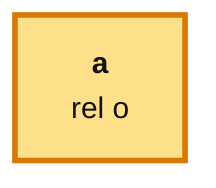

| # | activity | objects |
|---|---|---|
| e1 | a | o1 |
| **e2** 🟨 | **x** | **o1** |

Object traces: o1: ⟨a, x⟩

**Pattern values** (1 = pattern holds, i.e. behaviour present/allowed; for identity: implication violated / not enforced; — = not part of that implementation's pattern universe; ⚠️ = differs from the paper reference):

| pattern | Python log | Python tree | rust4pm log | rust4pm tree | Paper (reference) log | Paper (reference) tree |
|---|---|---|---|---|---|---|
| rel(a,o) | 1 | 1 | 1 | 1 | 1 | 1 |
| rel(x,o) | 1 | 0 | 1 | 0 | 1 | 0 |

**Category scores:**

| | control fit / prec | multiplicity fit / prec | identity fit / prec |
|---|---|---|---|
| Python | 0.333 / 0.500 | 0.667 / 1.000 | 1.000 / 1.000 |
| rust4pm | 0.333 / 0.500 | 0.667 / 1.000 | 1.000 / 1.000 |
| Paper (reference) | 0.333 / 0.500 | 0.500 / 1.000 | 1.000 / 1.000 |

> **Question:** Should the universe be the set Σ<sub>log</sub> ∪ Σ<sub>tree</sub> (paper), or is the weighting intended?

## 11. Identity: object-wise check flags a violation that Def. 4 does not

**Result:** Python ⚠️ differs from paper · rust4pm ⚠️ differs from paper

**Paper.** Def. 4 (set-wise): ot implies ot′ across a, b if any two events with **equal ot-sets** have equal ot′-sets. Here the o-sets {o1} and {o1, o2} differ, so nothing is constrained and the implication o ⇒ i holds.

**Implementations.** Python `check_relation_log` (`OCPT-Conformance-Checking/src/identity_relation.py:9-35`) and rust4pm `check_implication` (`object_centric_language_abstraction.rs:916`) check **per object**. Every o-object (check2), or every object (check1), must always occur with the same (o ∪ i)-set. o1 occurs with {o1,i1} and {o1,o2,i2}, so both report a violation. The per-object check implies Def. 4 (for non-empty ot-sets), but not the other way round.

**Separating example** (`cases/11_identity_objectwise_stricter/`). Highlighted nodes and events are where the behaviour diverges.

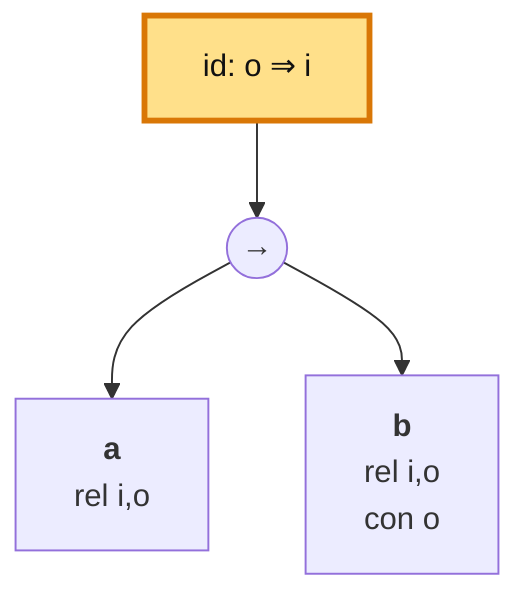

| # | activity | objects |
|---|---|---|
| **e1** 🟨 | **a** | **o1, i1** |
| **e2** 🟨 | **b** | **o1, o2, i2** |

Object traces: i1: ⟨a⟩; i2: ⟨b⟩; o1: ⟨a, b⟩; o2: ⟨b⟩

**Pattern values** (1 = pattern holds, i.e. behaviour present/allowed; for identity: implication violated / not enforced; — = not part of that implementation's pattern universe; ⚠️ = differs from the paper reference):

| pattern | Python log | Python tree | rust4pm log | rust4pm tree | Paper (reference) log | Paper (reference) tree |
|---|---|---|---|---|---|---|
| implies(a,b : o⇒i) | **1** ⚠️ | 0 | **1** ⚠️ | 0 | 0 | 0 |

**Category scores:**

| | control fit / prec | multiplicity fit / prec | identity fit / prec |
|---|---|---|---|
| Python | 0.625 / 0.833 | 0.500 / 1.000 | 0.000 / 0.000 |
| rust4pm | 0.625 / 0.833 | 0.500 / 1.000 | 0.000 / 0.000 |
| Paper (reference) | 0.625 / 0.833 | 0.625 / 1.000 | 1.000 / 0.000 |

> **Question:** Is the intended semantics the set-wise implication of Def. 4, or the stronger per-object synchronisation the code checks?

## 12. Identity: events without objects of the implying type are ignored by the implementations

**Result:** Python ⚠️ differs from paper · rust4pm ⚠️ differs from paper

**Paper.** Def. 4 compares all a/b events, including those with an **empty** ot-set. Events 3 and 4 have no o-object (o-set ∅ for both) but different i-sets, so o ⇒ i is violated.

**Implementations.** Both implementations only group by objects. Events without an o-object never take part in check2, and check1 is satisfied because i1 and i2 each occur once.

**Separating example** (`cases/12_identity_empty_set/`). Highlighted nodes and events are where the behaviour diverges.

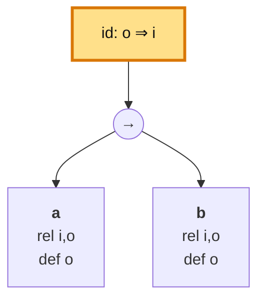

| # | activity | objects |
|---|---|---|
| e1 | a | o1, i3 |
| e2 | b | o1, i3 |
| **e3** 🟨 | **a** | **i1** |
| **e4** 🟨 | **b** | **i2** |

Object traces: i1: ⟨a⟩; i2: ⟨b⟩; i3: ⟨a, b⟩; o1: ⟨a, b⟩

**Pattern values** (1 = pattern holds, i.e. behaviour present/allowed; for identity: implication violated / not enforced; — = not part of that implementation's pattern universe; ⚠️ = differs from the paper reference):

| pattern | Python log | Python tree | rust4pm log | rust4pm tree | Paper (reference) log | Paper (reference) tree |
|---|---|---|---|---|---|---|
| implies(a,b : o⇒i) | **0** ⚠️ | 0 | **0** ⚠️ | 0 | 1 | 0 |

**Category scores:**

| | control fit / prec | multiplicity fit / prec | identity fit / prec |
|---|---|---|---|
| Python | 0.750 / 1.000 | 0.750 / 1.000 | 1.000 / 0.000 |
| rust4pm | 0.750 / 1.000 | 0.750 / 1.000 | 1.000 / 0.000 |
| Paper (reference) | 0.750 / 1.000 | 0.750 / 1.000 | 0.000 / 0.000 |

> **Question:** Should events without objects of the implying type count (Def. 4 as written)? This interacts with deficiency: the tree allows o to be missing at a and b.

## 13. Identity universe: pairs with a = b are excluded by the implementations

**Result:** Python ⚠️ differs from paper · rust4pm ⚠️ differs from paper

**Paper.** Def. 9 ranges over all activity pairs a, b ∈ U<sub>act</sub> (|Σ|² of them), so (a, a) is included. The two a-events share o1 but have different i-objects, which violates o ⇒ i within a.

**Implementations.** Both implementations skip `a == b` and `ot1 == ot2` (Python `OCPT-Conformance-Checking/src/conformance.py:51`, rust4pm `footprint_based_ocpt.rs:277/282`). Here the violation is invisible ('—' = not a pattern), and identity fitness stays 1.0.

**Separating example** (`cases/13_identity_same_activity/`). Highlighted nodes and events are where the behaviour diverges.

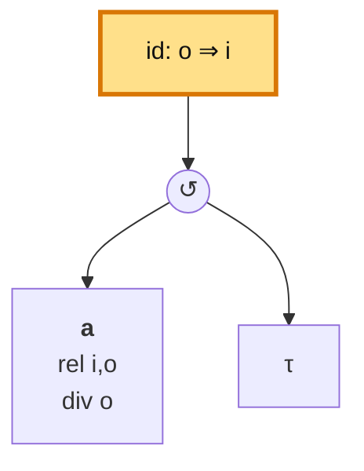

| # | activity | objects |
|---|---|---|
| **e1** 🟨 | **a** | **o1, i1** |
| **e2** 🟨 | **a** | **o1, i2** |

Object traces: i1: ⟨a⟩; i2: ⟨a⟩; o1: ⟨a, a⟩

**Pattern values** (1 = pattern holds, i.e. behaviour present/allowed; for identity: implication violated / not enforced; — = not part of that implementation's pattern universe; ⚠️ = differs from the paper reference):

| pattern | Python log | Python tree | rust4pm log | rust4pm tree | Paper (reference) log | Paper (reference) tree |
|---|---|---|---|---|---|---|
| implies(a,a : o⇒i) | **—** ⚠️ | **—** ⚠️ | **—** ⚠️ | **—** ⚠️ | 1 | 0 |

**Category scores:**

| | control fit / prec | multiplicity fit / prec | identity fit / prec |
|---|---|---|---|
| Python | 1.000 / 0.833 | 1.000 / 0.600 | 1.000 / 1.000 |
| rust4pm | 1.000 / 0.833 | 1.000 / 0.500 | 1.000 / 1.000 |
| Paper (reference) | 1.000 / 0.833 | 1.000 / 0.600 | 0.000 / 0.000 |

> **Question:** Are same-activity pairs part of the identity footprint? If not, Sec. 3.2's count |Σ|²|Ω|² should be adjusted.

## 14. Identity: a pattern that never applies in the log counts as violated (1) in the implementations

**Result:** Python ⚠️ differs from paper · rust4pm ⚠️ differs from paper

**Paper.** Def. 9: the pattern is 1 if the implication is **violated** in the log. Activity b never occurs, so nothing is violated and the value is 0.

**Implementations.** Both implementations push `not (ot1,ot2,a,b) in log_ident` (Python `OCPT-Conformance-Checking/src/conformance.py:50`, rust4pm `footprint_based_ocpt.rs:292`), but `log_ident` only contains pairs that were checked and satisfied. A pair that never applies in the log is therefore 1 ("violated") whenever the tree relates both activities to both types.

**Side effect worth deciding together:** with the paper's literal reading, the tree side is 1 for every pair that is not under an identity node. The log side is 0 unless something is violated. Identity **precision** is then 0 whenever the tree has few identity nodes: the paper-reference column shows 0.0 for identity precision in most cases of this report. The implementations' convention avoids that, at the cost of fitness loss here.

**Separating example** (`cases/14_identity_vacuous/`). Highlighted nodes and events are where the behaviour diverges.

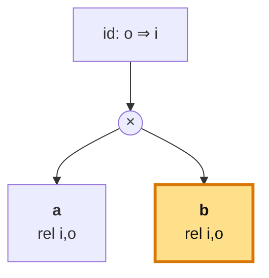

| # | activity | objects |
|---|---|---|
| e1 | a | o1, i1 |
| e2 | a | o2, i2 |

Object traces: i1: ⟨a⟩; i2: ⟨a⟩; o1: ⟨a⟩; o2: ⟨a⟩

**Pattern values** (1 = pattern holds, i.e. behaviour present/allowed; for identity: implication violated / not enforced; — = not part of that implementation's pattern universe; ⚠️ = differs from the paper reference):

| pattern | Python log | Python tree | rust4pm log | rust4pm tree | Paper (reference) log | Paper (reference) tree |
|---|---|---|---|---|---|---|
| implies(a,b : o⇒i) | **1** ⚠️ | 0 | **1** ⚠️ | 0 | 0 | 0 |

**Category scores:**

| | control fit / prec | multiplicity fit / prec | identity fit / prec |
|---|---|---|---|
| Python | 1.000 / 0.500 | 1.000 / 0.333 | 0.500 / 1.000 |
| rust4pm | 1.000 / 0.500 | 1.000 / 0.333 | 0.500 / 1.000 |
| Paper (reference) | 1.000 / 0.500 | 1.000 / 0.250 | 1.000 / 0.000 |

> **Question:** Which value should an identity pattern have when it never applies in the log? And how should identity precision behave for trees without identity nodes?

## 15. Identity: rust4pm reads Sync as both directions, Python only as left ⇒ right

**Result:** Python ⚠️ differs from paper · rust4pm ✅ agrees with paper

**Paper.** The paper only has implications; a synchronisation node is two implications (o ⇒ i and i ⇒ o). The reference follows that.

**Implementations.** rust4pm adds the reverse direction for `IdentityRelationKind::Sync` (`object_centric_language_abstraction.rs:990`). The Python repo encodes identity nodes as a directed tuple `(ot1, ot2)` (`OCPT-Conformance-Checking/src/tree_abstraction.py:32-40`), so it only enforces o ⇒ i. The log violates i ⇒ o (i1 occurs with o1 and with o2). Only rust4pm and the paper flag it.

**Separating example** (`cases/15_identity_sync_symmetry/`). Highlighted nodes and events are where the behaviour diverges.

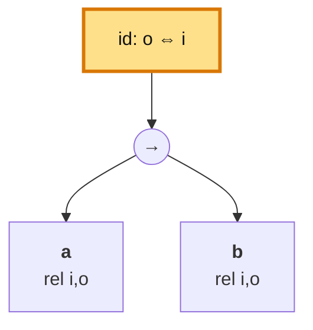

| # | activity | objects |
|---|---|---|
| **e1** 🟨 | **a** | **o1, i1** |
| **e2** 🟨 | **b** | **o2, i1** |

Object traces: i1: ⟨a, b⟩; o1: ⟨a⟩; o2: ⟨b⟩

**Pattern values** (1 = pattern holds, i.e. behaviour present/allowed; for identity: implication violated / not enforced; — = not part of that implementation's pattern universe; ⚠️ = differs from the paper reference):

| pattern | Python log | Python tree | rust4pm log | rust4pm tree | Paper (reference) log | Paper (reference) tree |
|---|---|---|---|---|---|---|
| implies(a,b : o⇒i) | 0 | 0 | 0 | 0 | 0 | 0 |
| implies(a,b : i⇒o) | 1 | **1** ⚠️ | 1 | 0 | 1 | 0 |

**Category scores:**

| | control fit / prec | multiplicity fit / prec | identity fit / prec |
|---|---|---|---|
| Python | 0.714 / 0.833 | 0.667 / 1.000 | 1.000 / 1.000 |
| rust4pm | 0.714 / 0.833 | 0.667 / 1.000 | 0.000 / 1.000 |
| Paper (reference) | 0.714 / 0.833 | 0.667 / 1.000 | 0.000 / 1.000 |

> **Question:** In the Python version, how are symmetric relations supposed to enter the conformance check (two nodes, or a kind)?

## 16. Tree `opt`: an activity in a loop's redo part can occur zero times, but no pattern says so

**Result:** Python ✅ agrees with paper · rust4pm ⚠️ differs from paper

**Paper.** Sec. 3.3: rel<sub>a<1,ot</sub> holds if a leaf allows it or there is a **choice** on the path. Loops are not mentioned. But a redo part (b) can occur zero times, so a<1 is reachable for b. Read literally, the paper misses this, and the reference reproduces the literal rule.

**Implementations.** rust4pm initialises optionality from divergence (`object_centric_language_abstraction.rs:111`, `compute_opt`). Every activity under a loop (div via loop) becomes optional, including the **body** a, which always occurs at least once. Python (`tree_abstraction.py:142-143`) follows the paper.

**Separating example** (`cases/16_tree_opt_loop_redo/`). Highlighted nodes and events are where the behaviour diverges.

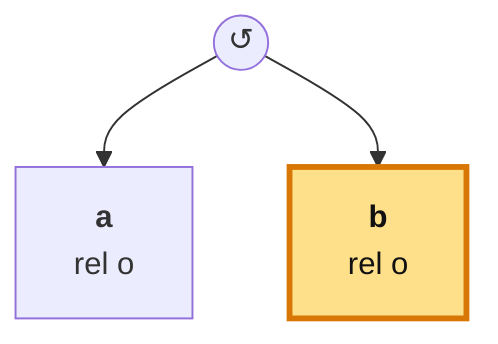

| # | activity | objects |
|---|---|---|
| **e1** 🟨 | **a** | **o1** |
| e2 | a | o2 |
| e3 | b | o2 |
| e4 | a | o2 |

Object traces: o1: ⟨a⟩; o2: ⟨a, b, a⟩

**Pattern values** (1 = pattern holds, i.e. behaviour present/allowed; for identity: implication violated / not enforced; — = not part of that implementation's pattern universe; ⚠️ = differs from the paper reference):

| pattern | Python log | Python tree | rust4pm log | rust4pm tree | Paper (reference) log | Paper (reference) tree |
|---|---|---|---|---|---|---|
| opt (a<1)(a,o) | 0 | 0 | 0 | **1** ⚠️ | 0 | 0 |
| opt (a<1)(b,o) | 1 | 0 | 1 | **1** ⚠️ | 1 | 0 |
| div (a>1)(b,o) | 0 | 1 | 0 | 1 | 0 | 1 |

**Category scores:**

| | control fit / prec | multiplicity fit / prec | identity fit / prec |
|---|---|---|---|
| Python | 1.000 / 0.800 | 0.667 / 0.500 | 1.000 / 1.000 |
| rust4pm | 1.000 / 1.000 | 1.000 / 0.667 | 1.000 / 1.000 |
| Paper (reference) | 1.000 / 1.000 | 0.750 / 0.750 | 1.000 / 1.000 |

> **Question:** Intended rule for a<1 under loops: redo parts only (semantically exact), body and redo (rust4pm), or neither (paper text, Python)?


## 17. Evaluation script: Table 1 "Absolute Difference" uses one category only

*No separating example. This is about how the published numbers were produced.*

- `main.py:46-47` (`compare_values`) uses `get_fitness(...)[0]` and `get_precision(...)[0]`. That is the **control-flow category only**, not the category average.
- The trees are mined with `df2_miner_apply(path)` with `ident=False`, so they contain no identity nodes.
- Sec. 4.2 explains the precision gaps mainly through multiplicity and identity sensitivity.
- The committed `comparison.csv` reproduces Table 1 only roughly:

| Log | Table 1 (fit / prec) | `comparison.csv` (fit / prec) |
|---|---|---|
| Container | 0.02 / 0.08 | **0.18 / 0.12** |
| P2P | 0.17 / 0.12 | **0.02 / 0.08** |
| LRMS O2C | 0.00 / 0.08 | 0.00 / **0.12** |
| LRMS P2P | 0.04 / 0.02 | 0.04 / 0.01 |
| LRMS HR | 0.05 / 0.12 | 0.06 / 0.12 |
| Recruiting | 0.03 / 0.35 | 0.02 / 0.37 |
| Orders, Hospital | match | match |

The Container and P2P rows look swapped.

**Question:** Were the Table 1 values computed from all three categories, and is `comparison.csv` the current version?

## 18. Typos in the definitions

*No run needed.*

- **Def. 3:** the object-side multiplicity set uses "π<sub>act</sub>(o) = a". It should be π<sub>act</sub>(e) = a.
- **Def. 5:** "0 ∈ m<sub>ot</sub> ⇒ ot ∈ con<sub>a</sub>, 0 ∈ m<sub>ot</sub> ⇒ ot ∈ def<sub>a</sub>". The first should be MANY ∈ m<sub>ot</sub> ⇒ ot ∈ con<sub>a</sub>. The reference implementation uses this fixed reading.

## 19. Harmless code oddity (no behavioural effect)

`OCPT-Conformance-Checking/src/interaction_properties.py:39` filters `identifiers[identifiers[ot] != set()]`. That compares tuples with a set, so it is always true and filters nothing. Line 46 removes the empty tuple afterwards, so the result is unaffected. We found no input on which this changes an output.

## 20. Outside the footprint: DF2 graph loses end activities (Python miner)

*Python only. rust4pm's footprint does not use this code. It affects the trees the repo mines for its evaluation.*

`OCPT-Conformance-Checking/src/divergence_free_graph.py:32` builds `non_ends` from `local_start` instead of `local_end`. Every related activity that is not a *start* activity is then removed from the ends.

Example (`extra/df2_non_ends/`): one object, o1: ⟨a, **b**⟩.

| | start | end |
|---|---|---|
| expected (DF2 definition) | {a} | **{b}** |
| Python `get_divergence_free_graph` | {a} | **{}** ⚠️ |

**Question:** Confirm this is a typo (`local_end`).


## Appendix A: interpretations in the paper reference

Where the paper text is ambiguous or literally unworkable, `reference.py` makes these choices. Each one is easy to switch.

1. **Leaf skip** (see Issue 6): a leaf that is τ or unrelated to ot is skippable for ot. Use `--literal-leaf-skip` for the literal rule.
2. **res(S)** (eqs. 8, 14): ot is resource-like in S if every leaf of S *related to ot* has ot ∈ div. The text says "all leaf nodes".
3. **Loop skip**: not stated in the paper. A loop is skippable iff its body is.
4. **Def. 5**: MANY ∈ m<sub>ot</sub> ⇒ con (typo fix, Issue 18).
5. **Tree identity value**: 0 if (ot, ot′, a, b) is in the transitive closure of the identity nodes covering a and b, or if it holds in every log trivially (ot = ot′, or ot′ unrelated to a and b in the tree). Otherwise 1.
6. **Empty category**: fitness or precision is 1.0 if the denominator is 0, as in both implementations.
7. **Pattern universe**: Σ = Σ<sub>log</sub> ∪ Σ<sub>tree</sub>, Ω = Ω<sub>log</sub> ∪ Ω<sub>tree</sub>, as sets.

## Appendix B: reproducing

```bash
./run_all.sh <path to OCPT-Conformance-Checking checkout> ./shim
```

- `cases.py` defines all examples and writes `cases/<id>/`:
  - inputs: `events.json`, `log.json` (OCEL 2.0 JSON), `tree.json` (neutral format), `tree_rust.json` (serde OCPT)
  - outputs: `out_python.json`, `out_rust4pm.json`, `out_paper.json`, `out_paper_literal.json`
- The Python repo runs with pm4py 2.7.15 and pandas 2.2.3. Its Cython module `fast_hash` is replaced by a pure-Python file with identical logic, because the committed binary is a Windows `.pyd`.
- rust4pm runs through `rust_harness/`, which calls `OCLanguageAbstraction::create_from_ocel`, `create_from_oc_process_tree` and `compute_footprint_conformance_abstractions`.
- The Python repo has no notion of identity-relation kinds. Both `Sync` and `ImpOrdered` nodes become the directed tuple `(left, right)` there (see Issue 15).
