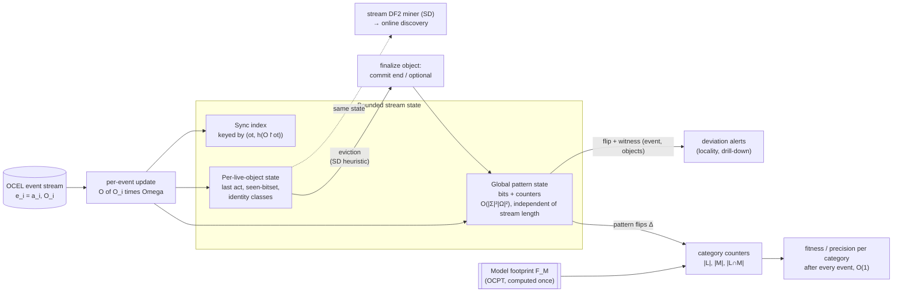
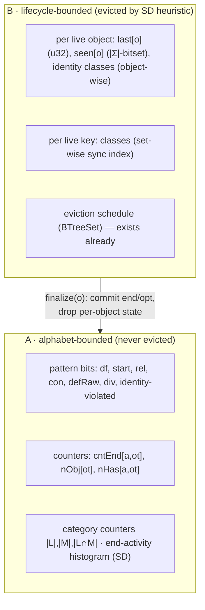
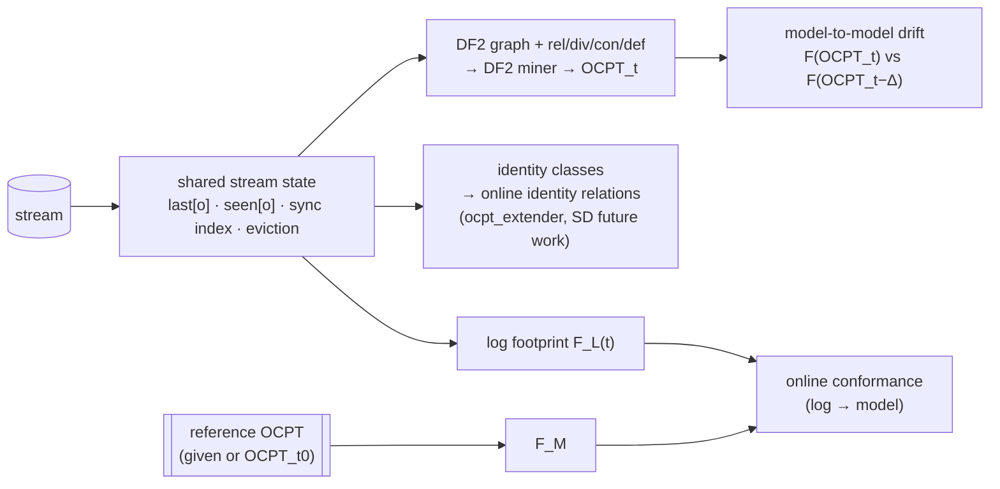

# Online Footprint Conformance for Object-Centric Process Trees — Plan

Working document. Nothing is implemented yet. It builds on two papers:

- **[FP]** van Detten et al., *Footprint-Based Conformance Checking for Object-Centric Process Trees* (BPM 2026). Offline implementation: `rust4pm_BPM`, module `conformance/object_centric/footprint_based_ocpt.rs` + `object_centric_language_abstraction.rs`.
- **[SD]** Mühlmeyer et al., *Discovering Object-Centric Process Trees from Event Streams* (BPMW 2026). Implementation: `backend/src/core/event_stream/miner.rs`.

---

## 0. Core idea in one picture

The footprint is a **fixed, finite vector of binary patterns** over the alphabet Σ and the object types Ω. On the model side it is computed **once**, offline, in polynomial time. On the log side every pattern can be decided from a small amount of state, and most patterns only ever flip 0→1. So online conformance is:

> keep a bounded **log-footprint state**, emit **pattern flips**, and keep three **counters per category**. Fitness and precision are then O(1) to read after every event.



---

## 1. Pattern catalogue and how each one is tracked online

There are three categories. **Exactness** means the online value equals the offline value on the materialized prefix `S≤n`, up to hash collisions, as long as no object is evicted. **Per-object memory** means the state lives on a live object and goes away when the object is evicted.

### 1.1 Control flow (|Σ|²|Ω| + 2|Σ||Ω| patterns)

| Pattern | Online witness | State | Monotone? | Exact w/o eviction |
|---|---|---|---|---|
| `df(a,b,ot)` | event `b` on object `o` with `last[o]=a` | `last[o]` (per object) | yes | ✔ |
| `start(a,ot)` | first event of `o` | "seen `o`" (per object) | yes | ✔ |
| `end(a,ot)` | `o` currently or finally ends with `a` | **counter** `cntEnd[a,ot]` = #objects whose current last is `a` | **no** (prefix semantics) | ✔ |

`end` is the one non-monotone control-flow pattern. On a prefix, the current last activity of an object that is still running is a provisional end. On `last[o]: x → y`, update `cntEnd[x]--` and `cntEnd[y]++`. Then `end(a,ot) ⇔ cntEnd[a,ot] > 0`. Evicted objects keep their contribution, and that contribution becomes the committed end.

### 1.2 Interaction multiplicities (5|Σ||Ω| patterns)

These follow the rust4pm semantics `rel, div, def, con, opt`, which differ slightly from paper Def. 8 (see §6).

| Pattern | Meaning | Online witness | State | Exact |
|---|---|---|---|---|
| `rel(a,ot)` | some `a`-event has an `ot`-object | event-local | 1 bit | ✔ |
| `con(a,ot)` | some `a`-event has >1 `ot`-objects | event-local | 1 bit | ✔ |
| `def(a,ot)` | related, and some `a`-event has 0 `ot`-objects | event-local raw bit ∧ `rel` | 1 bit | ✔ |
| `div(a,ot)` | some `ot`-object takes part in >1 `a`-events | `a ∈ seen[o]` already | `seen[o]` bitset (per object) | ✔ |
| `opt(a,ot)` | related, and some `ot`-object never takes part in `a` | **counters**: `nObj[ot] > nHas[a,ot]` | 2 counters | ✔ (prefix) |

`opt` is the "never" pattern. With counters it becomes O(1) and is exactly the test rust4pm does (`num_of_obj_with_ob_type > num_of_obj_with_ob_and_ev_type`). The pattern can only be **committed** for an object at the end of its lifecycle, so a second, *lifecycle-committed* view counts only finalized objects (§3.3).

### 1.3 Identity relations (≤ |Σ|²|Ω|² patterns)

`implies(a,b,ot,ot')` is *violated* if, across the events of `{a,b}`, the same `ot` identities occur together with different `ot'` identities.

**Representative lemma (the key to making this cheap).** Fix a key `k` (see the two variants below) and a partner type `ot'`. Group the activities seen under `k` by the `ot'`-hash they were observed with: `classes[k][ot'] : hash → ActSet`. Then

> `implies(a,b,·,ot')` is violated under `k` ⇔ the classes that contain `a` or `b` hold **≥ 2 distinct hashes**.

One representative per (activity, class) is therefore enough, and we never have to store event lists. On a new event `(b, h)`:

- every activity in a class other than `h` produces a newly violated pair with `b`;
- if `b` already sits in another class, every activity `x` present anywhere produces a violated pair `(b,x)`.

This is O(|Σ|/64) word operations per (key, ot') thanks to bitsets.

Two semantics for the key (**open decision D1**):

| | **Set-wise** (paper Def. 4) | **Object-wise** (rust4pm `check_implication`) |
|---|---|---|
| key | `(ot, h(O↾ot))` | each object `o` of type `ot` |
| compared hash | `h(O↾ot')` | `h(O↾{ot,ot'})` |
| state lives on | live sync-index keys | live objects (same as `last[o]`) |
| eviction | key dies when its first member object dies | dies with the object |
| bonus | **generalizes SD's divergence index `D`**: DF2-divergence(a,ot) ⇔ ∃ot' : `a` has ≥2 classes under some key | numbers match the current offline implementation |

Recommendation: implement the index generically over the key, and run both variants in the exactness tests (§5, step 1). The set-wise version gives the elegant **"one index for discovery and conformance"** story (see §4).

---

## 2. Per-event update (sketch of Algorithm 1)

```
on event e_i = (a, O):
  T ← types(O)
  for ot ∈ Ω:  n_ot ← |O↾ot|
      if n_ot ≥ 1: flip rel(a,ot);  if n_ot > 1: flip con(a,ot)
      if n_ot = 0: defRaw(a,ot) ← 1                # def = defRaw ∧ rel, evaluated lazily
  for o ∈ O (type ot):
      if o ∉ Live:  Live.add(o); flip start(a,ot); nObj[ot]++; cntEnd[a,ot]++
      else:         x ← last[o]; flip df(x,a,ot); cntEnd[x,ot]--; cntEnd[a,ot]++
      if a ∈ seen[o]: flip div(a,ot) else: seen[o].add(a); nHas[a,ot]++
      last[o] ← a; reschedule eviction(o)          # SD Beta-binomial schedule
  identity: for ot ∈ T, ot' ∈ T∖{ot}: update classes[key(ot)][ot'] with (a, hash) → flips
  (set-wise only) DF2 divergence falls out of the same update
  every flip p: 0→1  ⇒  counters(cat(p)).L++, and .LM++ if p ∈ F_M; emit alert(p, e_i)
  cleanup(): pop due evictions (SD heuristic) → finalize(o)
```

Cost per event: O(|O|·|Ω| + |T|²·|Σ|/64), independent of stream length.

`h` is a **commutative set hash** (for example the sum of mixed per-object 64-bit hashes). With it, `h(O↾ot)`, `h(O↾{ot,ot'})` = `h(O↾ot)+h(O↾ot')` and `h(O)` all come from one pass over `O`.

---

## 3. Bounded memory

### 3.1 State split



### 3.2 Bound (a theorem for the paper)

Assume at most `ω_max` objects per event (cap it if needed). SD's expiration zone guarantees that every object is evicted at most `T_max` events after it was last seen. So every live object occurred in one of the last `T_max` events:

```
|Live| ≤ T_max · ω_max              |LiveKeys| ≤ T_max · |Ω|        (set-wise: a key dies ≤ T_max after its last use)

Memory = O( |Σ|²|Ω|²  +  T_max · ω_max · (|Σ|/64 + c_id) )
```

Here `c_id` is the number of identity classes per object or key, which is in practice 1–2 per partner type. The first term depends only on the alphabet. The second is a hard cap set by the parameter. Without eviction (baseline), part A stays the same and part B grows with the number of objects seen.

### 3.3 What premature eviction does (one-sided errors)

When an object `o` is evicted but later shows up again (a "zombie"), each pattern is wrong in **one known direction**:

| Pattern | Effect of a zombie | Direction |
|---|---|---|
| `df` | edge `last[o]→a` missed | FN |
| `start` | spurious start `a` | FP |
| `end` (prefix counter) | old last stays counted | FP |
| `opt` | zombie counted as a new object missing earlier activities | FP |
| `div` | repeat not seen | FN |
| identity | conflicting identities not compared | FN |
| `rel`, `con`, `def` | none (event-local) | exact |

This gives a clean result: **#wrong log patterns ≤ c · #zombies**. It also suggests a cheap fix:

- **Zombie filter (optional extension):** a fixed-size Bloom filter of evicted object IDs (two rotating filters give it aging). It
  - **detects** zombies, which gives a live error estimate with no ground truth (SD names missing ground truth as a limitation);
  - **repairs** `start`, `opt` and `nObj` (we know `o` is not new);
  - **adapts** `T_hint`/`T_max` per object type from the observed zombie rate.

  It cannot repair `df`, `div` or identity, because those need the lost state.

### 3.4 Two views of the log footprint

| View | Meaning | `end` / `opt` count | Use |
|---|---|---|---|
| **prefix-exact** | equals offline on `S≤n` | all objects, live ones included | correctness proofs, comparison with offline |
| **lifecycle-committed** | only completed lifecycles | finalized objects only | real monitoring: running objects are not deviations yet |

Both are just counters, so we maintain both.

---

## 4. Synergy with online discovery (SD)



- SD's stream state already holds `last[o]`, start candidates, the end histogram, divergence index `D` and the eviction schedule. The footprint state is a **strict superset** of it.
- The set-wise sync index answers DF2 divergence **and** identity patterns. That closes SD's stated gap ("ignorance of identity relations … missing information in the stream state") and fits FP's conformance in the same pass.
- FP is offline at ~4 s per log. Online gives fitness and precision after every event, plus alerts with a witness event (FP's "locality").

---

## 5. Roadmap (in iteration order)

| # | Step | Output | Notes |
|---|---|---|---|
| 0 | **Pin semantics** against rust4pm (paper and implementation differ, see §6) | spec table | decide D1–D4 |
| 1 | `LogFootprintState` without eviction; property test: online at `n` == `OCLanguageAbstraction::create_from_ocel(S≤n)` for many `n` | exactness test using `event_stream/replayer.rs` | Theorem 1 (exact up to collisions) |
| 2 | Model footprint `F_M` from `OcptFE` (reuse `create_from_oc_process_tree`) + counter-based conformance; equal to `compute_footprint_conformance` at end of stream | streaming conformance values | O(1) query |
| 3 | Plug in SD eviction; measure memory vs. footprint deviation from offline (per category, FP/FN) | Pareto plots as in SD Fig. 6 | Theorem 2 (bound) + one-sided errors |
| 4 | Zombie Bloom filter: error estimate + repair + adaptive thresholds | ablation | optional |
| 5 | Windowed / decayed footprint for drift: store last-witness index per pattern → `F_L^W` | drift case study | open semantics for identity |
| 6 | Noise robustness: per-pattern support counts + threshold θ (binary patterns flip on one noisy event) | θ sweep | lossy counting if needed |
| 7 | Integration: backend stream node + frontend live conformance panel | demo | after the core is settled |

---

## 6. Open decisions (paper vs. implementation)

> Checked against the paper's repo (Nik314/OCPT-Conformance-Checking). Details and confirmed bugs are in [DEFINITIONS_CHECK.md](DEFINITIONS_CHECK.md). Short version: D1–D3 hold for the Python code too. On log `div`, Python uses DF2 divergence, while rust4pm and the paper use `a>1`. The tree directly-follows extraction in the Python code has several bugs.

- **D1 Identity semantics.** Set-wise (Def. 4) or object-wise (`check_implication`)? Object-wise also ORs in `check1`. See §1.3.
- **D2 Vacuous identity patterns.** rust4pm pushes `!ident.contains(key)`. A pattern with no co-occurrence in the log is therefore **1** (relaxed), and it becomes 0 once it applies and holds. This is **non-monotone**, unlike Def. 9 (violated ⇒ 1). Online, the identity log value then becomes "unseen or violated". Is that intended?
- **D3 Multiplicity patterns.** The paper has `rel, a>1, a<1, ot>1, ot<1`. The implementation has `rel, div, def, con, opt`. Here `div` means "object in >1 `a`-events", which is **not** DF2 divergence. `total_activities` is a concatenated list, so it double-counts, as a code comment admits.
- **D4 Universe growth.** Online, Σ and Ω grow. Do model-only and log-only activities enter the universe as soon as they appear? (Offline: union of both.)

---

## 7. Paper scoping

| Option | Content | Venue size | Assessment |
|---|---|---|---|
| A | Online footprint conformance only (§1–3) | workshop / short | mostly engineering; control flow and multiplicities are easy |
| **B (recommended)** | **One bounded stream state for discovery *and* conformance of OCPTs with identity relations**: incremental footprint + exactness theorem, representative lemma / sync index (subsumes `D`), memory bound + one-sided error analysis, zombie filter, eval vs. repeated offline FP and SD | full BPM / ICPM | closes the future work of **both** papers; the non-trivial part (identity, `end`/`opt` lifecycle semantics, error analysis) carries the paper |
| C | B + other formalisms: OC-Declare (FP §5 says the patterns can be expressed there), OC-DFG/OCPN footprints | journal extension | later |

**Evaluation (B):** the same 6–10 OCEL logs as FP and SD.
- **RQ1:** prefix-exactness.
- **RQ2:** latency per event vs. re-running offline FP on growing prefixes.
- **RQ3:** memory vs. footprint deviation (per category, FP/FN) across `[T_hint, T_max]`.
- **RQ4:** drift detection on logs with injected drift (windowed variant).
